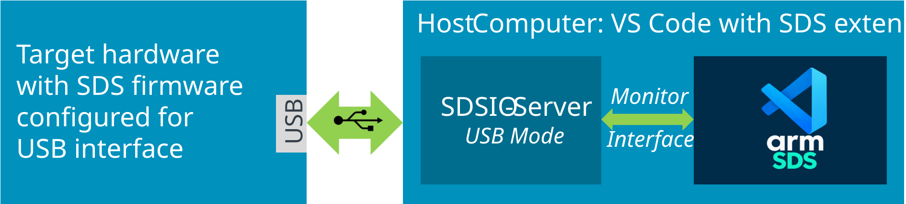
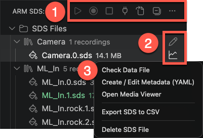
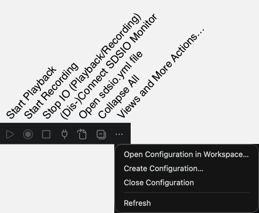
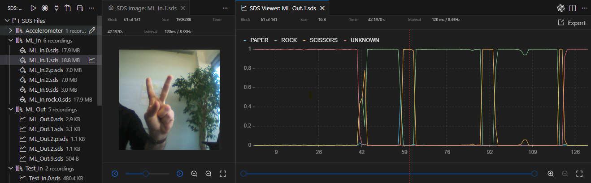
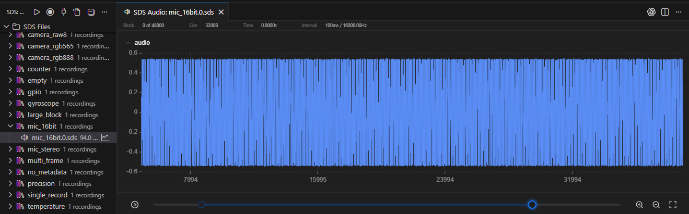
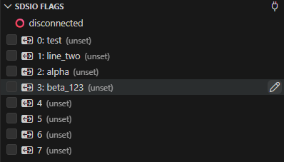

[](https://github.com/Open-CMSIS-Pack/vscode-cmsis-sds/releases)
[](LICENSE)
[](https://github.com/Open-CMSIS-Pack/vscode-cmsis-sds/actions/workflows/ci.yml?query=branch:main)
[](https://github.com/Open-CMSIS-Pack/vscode-cmsis-sds/actions/workflows/markdown.yml?query=branch:main)
[](https://github.com/Open-CMSIS-Pack/vscode-cmsis-sds/actions/workflows/codeql.yml?query=branch:main)
[](https://securityscorecards.dev/viewer/?uri=github.com/Open-CMSIS-Pack/vscode-cmsis-sds)
[](https://github.com/Open-CMSIS-Pack/vscode-cmsis-sds/actions/workflows/dependency-review.yml?query=branch:main)
[](https://qlty.sh/gh/Open-CMSIS-Pack/projects/vscode-cmsis-sds)
[](https://qlty.sh/gh/Open-CMSIS-Pack/projects/vscode-cmsis-sds)

# Arm SDS

Arm SDS is a VS Code extension for capturing, replaying, inspecting, and validating synchronous data streams
from embedded systems. It provides a graphical interface for the
[Synchronous Data Stream (SDS) Framework](https://www.keil.arm.com/packs/sds-arm/overview/), which brings reproducible
real-world sensor, audio, image, video, and algorithm data into DSP, ML, and Edge AI development. Captured streams can
be reviewed, labeled, and exported for offline analysis, DSP development, and ML training and testing.

SDS recordings turn real-world observations into reusable datasets and repeatable test cases. Use them to train or
optimize ML models, reproduce a problem, compare algorithm or model versions, and verify a change on target hardware or
an FVP simulation model. Arm SDS lets you review SDS data from both environments; its built-in SDSIO-Server connects
only to physical targets to record and play back data.

> **Demo video coming soon:** Load an existing [`*.sdsio.yml` control file](https://arm-software.github.io/SDS-Framework/main/utilities.html#sdsio-control-file-sdsioyml), show recorded images, connect to a target, record images, and play the recorded images back to the target.

<!-- Replace this placeholder with the final linked video thumbnail. -->
<!-- [](VIDEO_URL) -->

## What you can do

- Capture real-world sensor and media data from an embedded target and preserve it as a reusable engineering asset.
- Explore synchronized inputs and algorithm results together to understand system behavior and identify problems.
- Replay the same inputs to reproduce issues and compare algorithms, models, parameters, targets, or software versions.
- Turn recordings into repeatable test cases and datasets for DSP and ML development, validation, regression testing,
  and CI workflows.

## How it works

The [SDS Framework](https://www.keil.arm.com/packs/sds-arm/overview/) manages periodic fixed-size data
blocks as well as variable-size or irregularly timed streams. An SDS-enabled application can record sensor, audio,
image, and video input streams together with algorithm output. During playback, it feeds previously captured streams
into the application while recording new output, enabling repeatable validation and optimization.

The diagram below shows a target connected through USB. A physical
target can also connect through a serial port, a TCP/IP socket, or an RTT connection. See
the [SDS template application](https://arm-software.github.io/SDS-Framework/main/template.html) for the target-side
application structure and instructions for configuring these interfaces.



The Arm SDS VS Code extension provides a user interface for the SDSIO-Server and SDS data file viewers. It uses the following files:

| File | Purpose |
|------|---------|
| [`*.sdsio.yml` control file](https://arm-software.github.io/SDS-Framework/main/utilities.html#sdsio-control-file-sdsioyml) | Controls the SDSIO interface, working directories, playback test cases, and flag labels. |
| `*.sds` | SDS data file that stores a recorded synchronous data stream. |
| `*.sds.yml` or `*.sds.yaml` | Describes stream names, data types, sample rates, scaling, units, and media formats. |

## Prerequisites

Recording data from or playing data back to a target requires:

- A physical target running an application that integrates the SDS Framework and an SDSIO Client interface. The
  application defines the streams to record or play and transfers them through USB, serial, a TCP/IP socket, or an RTT
  connection exposed as a local socket. The
  [SDS template application](https://arm-software.github.io/SDS-Framework/main/template.html) provides a starting point
  for integrating SDS with target hardware and an algorithm.
- An [`*.sdsio.yml` control file](https://arm-software.github.io/SDS-Framework/main/utilities.html#sdsio-control-file-sdsioyml) that matches the SDSIO interface implemented by the target. It configures the target
  connection, directories for SDS data and metadata files, and optional playback steps. You can create this file with
  **Create Configuration** or open one supplied with an [SDS example](https://github.com/Arm-Examples/SDS-Examples).

The target application must be running and its configured USB, serial, network, or debug connection must be available
before Arm SDS can connect through the SDSIO-Server. Existing SDS recordings can be inspected without a
connected target.

## Workflow

1. Open the matching [`*.sdsio.yml` control file](https://arm-software.github.io/SDS-Framework/main/utilities.html#sdsio-control-file-sdsioyml) and connect Arm SDS to the SDS-enabled target.
2. Capture changing real-world sensor, audio, image, or video input streams, optionally together with algorithm output.
3. Inspect and label the recording, then preserve it as a reusable engineering asset.
4. Replay the captured input streams on hardware or an FVP simulation model while recording new algorithm output.
5. Compare results across models, parameter sets, targets, or software versions and add the test to regression or CI.

This workflow makes failures reproducible and provides evidence that an algorithm change fixes the original condition.
[Making Edge AI development more productive](https://developer.arm.com/community/arm-community-blogs/b/tools-software-ides-blog/posts/making-edge-ai-development-more-productive) exemplifies the overall development flow for ML applications.

## Connect to a target

The SDSIO-Server records and plays SDS data through a physical target connection. It supports USB, serial,
and TCP/IP socket interfaces; RTT connections use a local socket exposed by the debug adapter. FVP simulation does not
use the SDSIO-Server, but connects through the VSI3 interface using the same [`*.sdsio.yml` control file](https://arm-software.github.io/SDS-Framework/main/utilities.html#sdsio-control-file-sdsioyml).

1. Open the **SDS** view and select **Open SDS Configuration** to load an existing [`*.sdsio.yml` control file](https://arm-software.github.io/SDS-Framework/main/utilities.html#sdsio-control-file-sdsioyml). Use
   **New SDS Configuration** only when starting a new configuration.
2. Select **Connect SDSIO Monitor**. Arm SDS starts the server with the active [`*.sdsio.yml` control file](https://arm-software.github.io/SDS-Framework/main/utilities.html#sdsio-control-file-sdsioyml) and connects the monitor to it.
3. Use **Record**, **Play**, **Stop**, and the user flags to interact with the target.

## Configure an SDS workspace

The [`*.sdsio.yml` control file](https://arm-software.github.io/SDS-Framework/main/utilities.html#sdsio-control-file-sdsioyml) configures both the extension UI and the data workflow. For a target connection, it selects the SDSIO-Server interface. A new USB target configuration looks like this:

```yaml
sdsio:
  interface:
    usb:
  workdir: .
  metadir: .
  play:
    - step: Baseline test
      labels:
        - 0
  flag-info:
    - 0: Enable preprocessing
    - 1: Input variant B
    - 2: Record camera input
```

| Property | Description |
|----------|-------------|
| `interface` | Selects the USB, serial, or socket connection between a target and SDSIO-Server. Ignored by the VSI3 interface of FVP simulation models. |
| `workdir` | Directory containing recorded `.sds` files, relative to the [`*.sdsio.yml` control file](https://arm-software.github.io/SDS-Framework/main/utilities.html#sdsio-control-file-sdsioyml). |
| `metadir` | Directory containing `*.sds.yml` metadata, relative to the [`*.sdsio.yml` control file](https://arm-software.github.io/SDS-Framework/main/utilities.html#sdsio-control-file-sdsioyml). |
| `play` | Defines files and test cases available for playback. |
| `flag-info` | Labels for the eight application flags shown in the SDS View. |

## User interface

Open the **SDS** view from the VS Code Activity Bar. It combines the active [`*.sdsio.yml` control file](https://arm-software.github.io/SDS-Framework/main/utilities.html#sdsio-control-file-sdsioyml), target connection controls,
user flags, stream groups, metadata, and SDS recordings.



1. The **SDS View Toolbar** contains **Actions** for playback, recording, target connection, configuration-file
   access, and other commands.
2. **Tree View item inline actions** provide frequently used commands for a specific SDS stream or file, such as
   editing its metadata or opening it in the SDS Viewer.
3. The **Tree View item context menu** provides all commands available for the selected item, including validation,
   metadata editing, viewing, CSV export, and deletion.

### Commands

The View Actions and item menus provide commands for target control, configuration management, and SDS files. You can
also open the VS Code [Command Palette](https://code.visualstudio.com/docs/getstarted/userinterface#_command-palette)
and type **SDS** to find commands that apply without a selected Tree View item.



Command | What it does
--- | ---
Start Playback | Connect to the SDSIO-Server if necessary, select a configured playback test case, and start playback to the target.
Start Recording | Connect to the SDSIO-Server if necessary and start recording SDS streams from the target.
Stop IO (Playback/Recording) | Stop the active recording or playback operation.
(Dis-)Connect SDSIO Monitor | Start or stop the SDSIO-Server using the target information in the active [`*.sdsio.yml` control file](https://arm-software.github.io/SDS-Framework/main/utilities.html#sdsio-control-file-sdsioyml).
Open sdsio.yml file | Open the active [`*.sdsio.yml` control file](https://arm-software.github.io/SDS-Framework/main/utilities.html#sdsio-control-file-sdsioyml) in the editor.
Open Configuration in Workspace | Select an [`*.sdsio.yml` control file](https://arm-software.github.io/SDS-Framework/main/utilities.html#sdsio-control-file-sdsioyml) found in the current workspace and make it active.
Create Configuration | Create an [`*.sdsio.yml` control file](https://arm-software.github.io/SDS-Framework/main/utilities.html#sdsio-control-file-sdsioyml) from the default template, make it active, and open it in the editor.
Open SDS Configuration | Select an [`*.sdsio.yml` control file](https://arm-software.github.io/SDS-Framework/main/utilities.html#sdsio-control-file-sdsioyml) with a file picker. If it is outside the workspace, open its folder as the workspace.
Close Configuration | Close the active [`*.sdsio.yml` control file](https://arm-software.github.io/SDS-Framework/main/utilities.html#sdsio-control-file-sdsioyml).
Refresh | Refresh the SDS View.
Open SDS Viewer | Open an SDS file in the interactive data viewer; prompt for a file when none is selected.
Open Media Viewer | Open image, audio, or video content from an SDS file in the media viewer.
Check Data File | Run SDS Check from the installed SDS pack on the selected SDS file.
Export SDS to CSV | Decode the selected SDS file using its metadata and save the data as CSV.
Create / Edit Metadata (YAML) | Create a metadata template when needed and open the stream's metadata file in the editor.
Open Metadata Information | Open the existing metadata file associated with an SDS stream group.
Delete SDS File | Confirm and permanently delete the selected SDS file, then refresh the SDS View.
Quick Open SDS File | Find SDS files in the workspace, select one with Quick Pick, and open it in the SDS Viewer.
Initialize SDS Workspace | Open or create a workspace and ensure that it contains an `sds_recordings` directory.
Show Diagnostics | Show the **Arm SDS** output channel.
Clear Diagnostics Log | Clear the **Arm SDS** output channel.

### View SDS data

Open an `.sds` file from the SDS View. Its
[`*.sds.yml` metadata](https://arm-software.github.io/SDS-Framework/main/theory.html#yaml-metadata-format) defines how
the stream is decoded and displayed. The SDS Viewer shows values and charts, while the Media Viewer handles audio,
image, and video. Related viewers synchronize by timestamp so you can correlate algorithm input and output streams.

Open viewers refresh automatically as complete records are appended to the recording. For data and audio charts:

- A view fitted to the entire recording expands to include new data.
- A zoomed historical range keeps its zoom and position.
- A zoomed range at the end follows incoming data while keeping the same time span.

Audio waveforms and playback use windowed requests. Playback starts at the left edge of the visible range. When that
range reaches the recording's end, playback can continue into arriving audio while enough data is available. Playback
stops when it catches up with the recording and does not restart automatically. A historical range plays only to its
selected end.

A paused image viewer follows new frames only when its last frame is selected. Selecting an older frame keeps that
selection, and incoming frames preserve spatial zoom and scroll.





### User flags

User flags are application-defined bits in the target's `sdsFlags` value. Arm SDS can set or clear these bits through
the SDSIO-Server monitor interface; the target application decides what each bit does. A single firmware image can
therefore select algorithm options, run A/B tests, or inject test conditions without rebuilding the application.

The `flag-info:` section of the [`*.sdsio.yml` control file](https://arm-software.github.io/SDS-Framework/main/utilities.html#sdsio-control-file-sdsioyml) assigns meaningful labels to the flags displayed by Arm SDS. These
labels are for the user interface and do not define the target behavior. Playback steps can also set or clear flags to
apply the required application state before replaying a stream. See
[User flags in the SDSIO documentation](https://arm-software.github.io/SDS-Framework/main/utilities.html#flag-info)
for the related `flag-info:`, `setflags:`, and `clearflags:` properties.

You can rename a flag in the SDS View; the label is saved in the active [`*.sdsio.yml` control file](https://arm-software.github.io/SDS-Framework/main/utilities.html#sdsio-control-file-sdsioyml).



## Settings

Configure Arm SDS under **Extensions > Arm SDS** in the VS Code Settings editor, which describes each option and its
default value. The SDSIO monitor-port setting is machine-scoped; when using a remote extension host, change it in
**Remote Settings**. Changes apply on the next connection.

## Troubleshooting

### The SDSIO-Server does not connect

- Make sure an [`*.sdsio.yml` control file](https://arm-software.github.io/SDS-Framework/main/utilities.html#sdsio-control-file-sdsioyml) is active and its `interface` matches the target firmware and connection.
- Confirm that the target application is running and its USB, Ethernet, or RTT connection is available.
- Open **View > Output**, select **Arm SDS**, and review the executable, [`*.sdsio.yml` control file](https://arm-software.github.io/SDS-Framework/main/utilities.html#sdsio-control-file-sdsioyml), monitor port, and errors.
- Disconnect before changing the [`*.sdsio.yml` control file](https://arm-software.github.io/SDS-Framework/main/utilities.html#sdsio-control-file-sdsioyml) or connection interface, then connect again.

### The preferred monitor port is unavailable

The local monitor uses TCP port `6060` by default. Before starting SDSIO, the extension checks the preferred port. If
it is occupied or access is denied, the operating system selects an available port, which is passed to both server and
client. The selected port appears in the **Arm SDS** output channel; the setting itself is not changed.

This check cannot detect firewall filtering, and another process could claim the port before server startup. If
problems persist, allow the SDSIO-Server through the local firewall or choose another
`cmsis-sds.sdsio.monitorPort` in VS Code User or Remote Settings.

### Recordings or metadata do not appear

- Check that `workdir` and `metadir` are valid paths relative to the active [`*.sdsio.yml` control file](https://arm-software.github.io/SDS-Framework/main/utilities.html#sdsio-control-file-sdsioyml).
- Refresh the SDS View after files are created outside VS Code.
- Check that metadata uses the stream-group base name and ends in `.sds.yml` or `.sds.yaml`.

### A viewer cannot decode a file

- Verify the data type, sample rate, block layout, and media properties in the associated metadata.
- Use **Check Data File** to verify the recording.
- Use **Open SDS Viewer** for sensor data and **Open Media Viewer** for audio, image, or video data.

### Check Data File cannot find SDS Check

SDS Check is provided by the SDS software pack. Install the
[Arm SDS pack](https://www.keil.arm.com/packs/sds-arm/overview/) and make sure its pack root is available through the
standard location or the `CMSIS_PACK_ROOT` environment variable. Restart VS Code after changing the environment.

## Links

- [Arm SDS pack overview](https://www.keil.arm.com/packs/sds-arm/overview/)
- [SDS Framework documentation](https://arm-software.github.io/SDS-Framework/main/index.html)
- [SDS template application](https://arm-software.github.io/SDS-Framework/main/template.html)
- [SDS data-file format](https://arm-software.github.io/SDS-Framework/main/theory.html)
- [SDS YAML metadata format](https://arm-software.github.io/SDS-Framework/main/theory.html#yaml-metadata-format)
- [`*.sdsio.yml` control file](https://arm-software.github.io/SDS-Framework/main/utilities.html#sdsio-control-file-sdsioyml)
- [SDS examples](https://github.com/Arm-Examples/SDS-Examples)
- [Report an Arm SDS extension issue](https://github.com/Open-CMSIS-Pack/vscode-cmsis-sds/issues)
